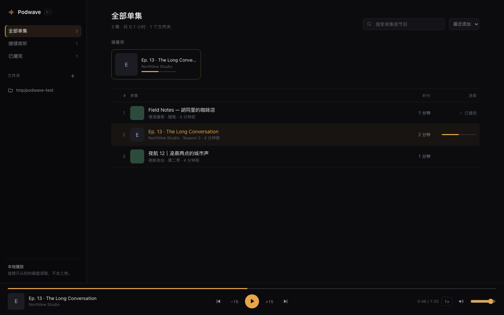

# Podwave

本地优先的播客播放器，为转写与双语字幕而生。

Podwave 直接读取你硬盘上的音频文件：不上传、不转码、不依赖云端账号。v0.1 先把「像播客客户端一样听本地文件」这件事做好，转写、说话人分离和双语字幕会沿着路线图逐步加进来。



## 现在能做什么

- **媒体库**：添加任意文件夹，递归扫描 mp3 / m4a / m4b / aac / wav / flac / ogg / opus
- **播放**：播放/暂停、±15 秒、上一集/下一集、0.75–2× 倍速、音量
- **续播**：每集记住播放位置，切集、暂停、播完都会保存，下次从断点继续
- **封面与标签**：读取 ID3 / MP4 标签和内嵌封面，没有封面时用标题首字占位
- **本地安全**：只监听 `127.0.0.1`，音频通过 Range 请求从本机读取，路径不离开配置的文件夹
- **键盘操作**：空格播放/暂停，`←` / `→` 退后/前进 15 秒，`↑` / `↓` 调音量，`/` 聚焦搜索
- **深色界面**，中文优先

## 快速开始

要求 Node.js ≥ 20。

```bash
npm install
npm run dev
```

打开 http://localhost:5173。

生产模式：

```bash
npm run build
npm start
```

打开 http://127.0.0.1:4780。

首次使用点侧边栏「文件夹」旁的 `+`，填入播客所在目录，例如：

```
~/Music/播客
/Users/you/Downloads/节目
```

Podwave 只读取，不会移动、重命名或修改任何文件。媒体库与播放进度保存在 `~/.podwave/`。

## 路线图

- **v0.2 转写引擎**：Qwen3-ASR（MLX）分块转写、词级时间戳、结果缓存
- **v0.3 说话人分离与字幕**：sherpa-onnx 说话人分离、跟播字幕、SRT / VTT / 双语 Markdown 导出
- **v0.4 翻译开关**：本地 LLM 或 API 翻译，双语对照随时切换
- **v0.5 媒体库增强**：RSS 订阅、播放队列、章节

## 技术结构

```
server/           Node.js + Express
  index.js        HTTP API、Range 音频流、静态资源
  library.js      文件夹扫描、标签解析、封面提取
  state.js        ~/.podwave/state.json 读写
web/              React + Vite
  src/App.jsx     播放器与列表界面
  src/styles.css  深色主题
```

- 音频流支持 `Range`，拖动进度条不需要整段缓冲
- 单集 ID 由文件绝对路径哈希得到，移动文件会视为新单集
- 标签解析用 [music-metadata](https://github.com/Borewit/music-metadata)，纯 JS，无原生依赖

## 数据与隐私

Podwave 不发送任何遥测。服务器只监听本机回环地址，音频和元数据都不会离开这台电脑。唯一的网络请求来自你自己打开的页面资源（本地）。

## License

[MIT](LICENSE)
